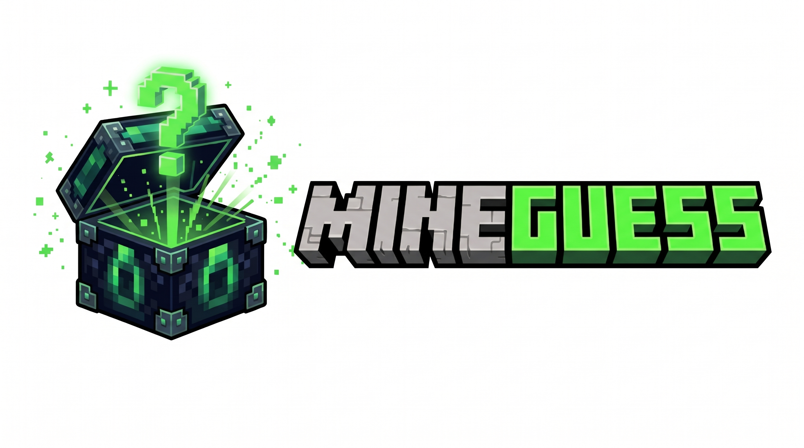

<p align="center">
  <picture>
    <source media="(prefers-color-scheme: dark)" srcset="assets/brand/banner-black.jpg">
    
  </picture>
</p>

<p align="center">
  <b>Wie gut kennst du Minecraft?</b><br>
  Das inoffizielle, kostenlose Quiz für alle, die jeden Block und jeden Mob kennen wollen.
</p>

<p align="center">
  <a href="https://mineguess.onrender.com"><b>Jetzt spielen</b></a>
</p>

> **Hinweis:** MineGuess ist ein Fan-Projekt. Es ist **kein offizielles Minecraft-Produkt** und weder von Mojang noch von Microsoft genehmigt oder mit ihnen verbunden. Minecraft-Texturen und -Namen © Mojang Studios / Microsoft.
> *NOT AN OFFICIAL MINECRAFT PRODUCT. NOT APPROVED BY OR ASSOCIATED WITH MOJANG OR MICROSOFT.*

## Was ist MineGuess?

Über **5000 Fragen** aus 18 Kategorien (Blöcke, Mobs, Redstone, Crafting, Biome, Verzauberungen und mehr). Du spielst allein, im Ranked oder mit Freunden im Raum, in dem es um die **Glocke** geht: Wer sie zuerst läutet, darf antworten.

Das Spiel läuft im Browser, ist kostenlos, braucht keine Anmeldung und lässt sich als App installieren.

## Das steckt drin

**Fragenformate**
- Zahlen schätzen, Mobs und Blöcke erkennen, Entweder-Oder, **Wahr oder Mythos**
- **Crafting-Rätsel:** Rezept sehen und das Ergebnis erraten, oder das Rezept selbst ins 3×3-Raster bauen, mit echten 3D-Icons für Stufen, Treppen, Zäune und mehr
- **Höher oder Tiefer** mit drei Leben

**Spielmodi (10)**
- Endlos, Blitz, Daily, Joker, Kategorien, Hardcore (ein Leben), Challenge-Link, Ranked, Höher oder Tiefer, Crafting
- **Challenge-Link:** Alle spielen dieselben 10 Fragen, und dein Ergebnis lässt sich ohne Spoiler teilen

**Ranked**
- Ränge von **Copper bis Netherite** mit MMR-System
- Die Fragen kommen vom Server, die Antworten werden dort geprüft, und das Ergebnis ist signiert. Wer von außen mogeln will, hat es schwer

**Multiplayer**
- Räume mit bis zu 8 Spielern, Glocke, Antwortphase, Totem, Votekick und Revanche
- **Teams** (2 bis 4) mit Namen, Symbol und Farbe, Team-Rangliste und Podium
- **Bau-Runde:** Alle bauen gleichzeitig ein Rezept, der Server prüft das Raster
- **Klassenraum ohne Konto:** Die Lehrkraft eröffnet den Raum mit einem Code, Schüler wählen einen Tier- oder Blocknamen aus einer festen Liste. Kein Chat, keine Personendaten, der Raum löscht sich selbst

**Profil und Freunde**
- Profil im Stil sozialer Netze mit Skin, Titeln, Vitrine, Banner und 36 Abzeichen
- Freundescode, Duelle, Freunde-Rangliste, Gruppen, Wochenziele
- **Kinderfreundlich:** Das Profil ist standardmäßig privat, es gibt keinen Chat, keine Bilder-Uploads und keinen Freitext zwischen Spielern

**Komfort und Barrierefreiheit**
- Deutsch und Englisch (Oberfläche), helles und dunkles Design
- Hoher Kontrast, lesbare Schrift, Textgröße, mehr Zeit im Solo-Modus
- Installierbar als Web-App (PWA), Offline-Cache

## Technik

| Bereich | Umsetzung |
|---|---|
| Server | Node.js, Express, Socket.io |
| Client | Vanilla-JS ohne Framework, WebGL-Szene, Canvas |
| Speicher | Datei, optional Firestore (Firebase Admin) |
| Anmeldung | Firebase Auth (Google), Gast ohne Anmeldung |
| Mails | Meldungen aus dem Spiel per Resend (REST-API) |
| Hosting | Render |
| Tests | `node:test`, aktuell 147 Tests |

Die Fragen entstehen aus `minecraft-data` (Java Edition 1.21.4) und selbst formulierten Fakten, belegt mit dem Minecraft Wiki. Skripte dafür liegen in `tools/`.

## Lokal starten

```bash
git clone https://github.com/AquariusAsal/mineguess.git
cd mineguess
npm install
node server.js        # läuft auf http://localhost:3000
npm test              # führt alle Tests aus
```

**Umgebungsvariablen** (alle optional, im Betrieb ist die erste wichtig):

| Variable | Zweck |
|---|---|
| `RANKED_SECRET` | Signiert Ranked-Läufe und Profil-Tokens. Im Betrieb setzen, sonst verfallen Tokens bei jedem Neustart |
| `FIREBASE_SERVICE_ACCOUNT` | Dienstkonto-JSON in einer Zeile, schaltet Firestore als Speicher ein |
| `RESEND_API_KEY` | Verschickt Meldungen aus dem Spiel per Mail |
| `REPORT_MAIL_TO` | Empfänger der Meldungen |
| `ADMIN_TOKEN` | Schaltet die geschützte Admin-Übersicht frei (mindestens 12 Zeichen) |
| `CSP_MODE` | `enforce` oder `off`, Standard ist Report-Only |

Nach jeder Datei- oder Asset-Änderung: `node tools/gen-sw-assets.js` (erzeugt den Service Worker neu).

## Datenschutz

Ohne Anmeldung werden keine Personendaten gespeichert. Meldungen aus dem Spiel enthalten keine IP und keine Nutzer-ID. Profile sind standardmäßig privat und lassen sich vollständig exportieren und löschen. Details stehen in `datenschutz.html`.

## Quellen und Hinweise

- Minecraft-Texturen und -Namen © Mojang Studios / Microsoft, genutzt nach den [Usage Guidelines](https://www.minecraft.net/en-us/usage-guidelines). Das Projekt ist nicht kommerziell.
- Fragen und Fakten basieren auf Inhalten des [Minecraft Wikis](https://de.minecraft.wiki), Lizenz CC BY-NC-SA 3.0, paraphrasiert.
- Schrift Atkinson Hyperlegible (SIL OFL), selbst gehostet.

## Urheberrecht

© 2026 Cuma Asal (Aquarius Asal). **Alle Rechte vorbehalten.** Der Quellcode, die Gestaltung, das Logo und die selbst verfassten Inhalte dürfen ohne schriftliche Genehmigung weder kopiert noch weitergegeben, verändert oder unter anderem Namen betrieben werden. Fremde Inhalte (Minecraft-Material, Wiki-Inhalte, Schrift, Bibliotheken) stehen unter ihren eigenen Lizenzen. Alle Details stehen in der Datei [LICENSE](LICENSE).

## Mitwirken

Fehler in einer Frage gefunden? Im Spiel auf **Melden** tippen, das geht in jedem Modus. Vorschläge sind willkommen. Code-Beiträge bitte vorher absprechen, da das Projekt nicht unter einer offenen Lizenz steht.
